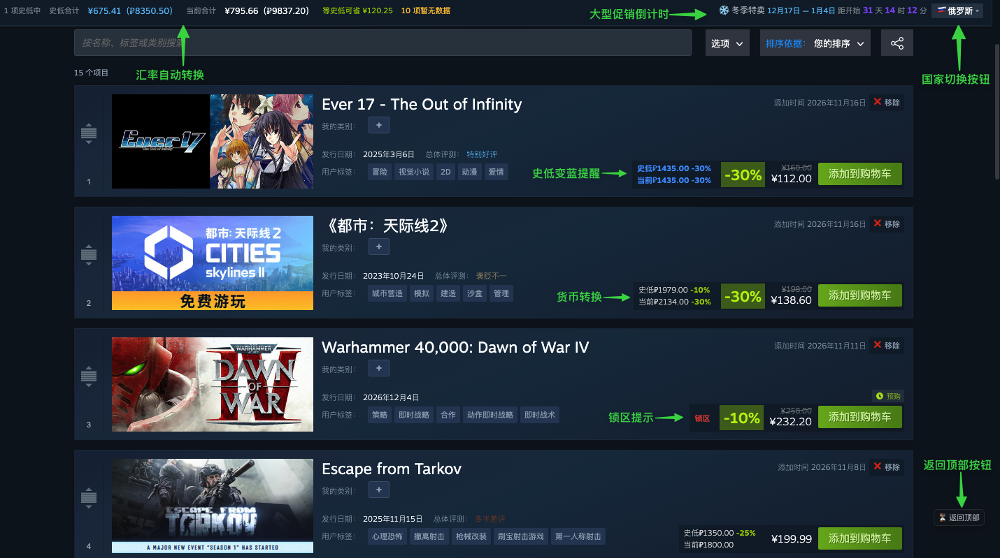
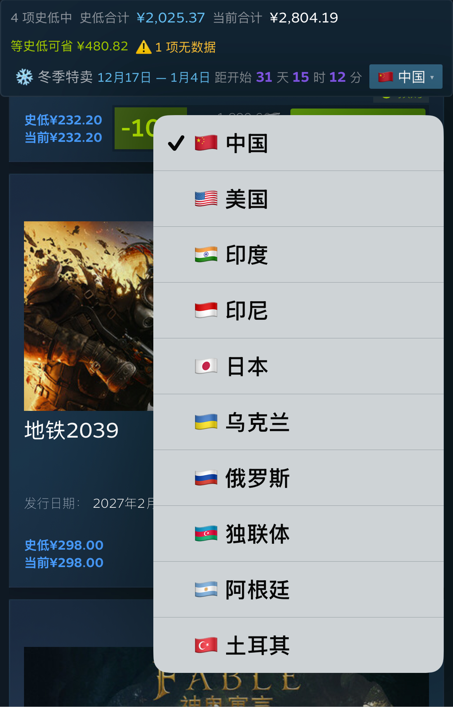
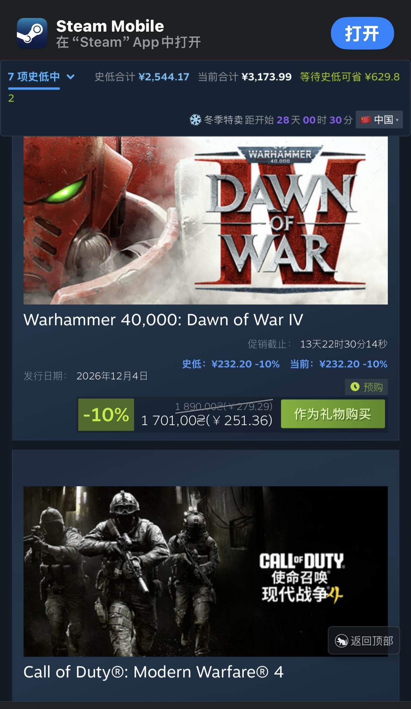
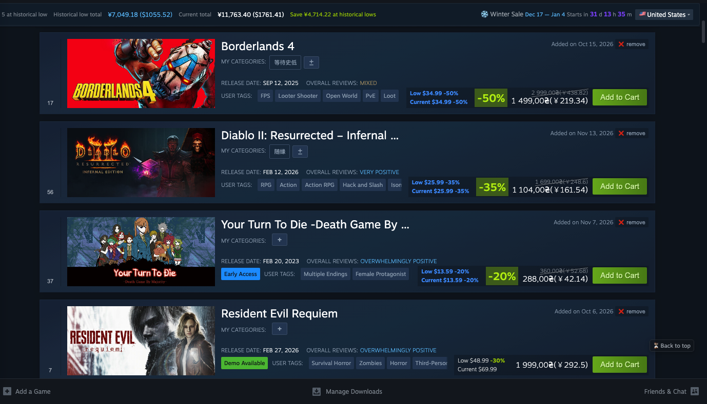

  <h1>
    
    Steam Wishlist Enhancer
  </h1>

A free userscript that enhances the Steam Wishlist page.

It only runs on **[Steam Wishlist](https://store.steampowered.com/wishlist)** and adds the following features to your wishlist:

### Historical Low Lookup

- Shows regional current prices and historical lows for each game directly in the wishlist.
- Region switcher: China🇨🇳, United States🇺🇸, India🇮🇳, Indonesia🇮🇩, Japan🇯🇵, Ukraine🇺🇦, Russia🇷🇺, CIS🇦🇿, Argentina🇦🇷, Türkiye🇹🇷.
- Historical low sources are selected automatically by region: China / US / India / Indonesia / Japan use [ITAD](https://isthereanydeal.com/); Ukraine / Russia / CIS / Argentina / Türkiye use the Xiaoheihe API.
- Historical lows are highlighted in blue, with discount percentages and no-data warnings.
- Price cache: considered fresh for 30 minutes and retained for up to 24 hours; requests are throttled to reduce API calls.

### Totals & Statistics

- Shows the wishlist "Current total" and "Historical low total".
- Shows the "Save at historical lows" amount.
- Converts totals to CNY using exchange rates; shows native-currency totals when applicable.

### Seasonal Sale Countdown

- Shows countdowns for Steam seasonal sales: Winter, Spring, Summer and Autumn Sales.
- Supports "Starts in / Ends in" countdowns.

## Screenshots

### *Feature Overview*

### *Region Switching*

### *Mobile Layout*

### *Steam Client Layout*

## Usage & Installation

### Userscript Manager

On PC, [Tampermonkey](http://tampermonkey.net/) is recommended. On iOS, [Stay](https://apps.apple.com/cn/app/stay-for-safari-%E7%94%A8%E6%88%B7%E8%84%9A%E6%9C%AC%E4%B8%8E%E5%B9%BF%E5%91%8A%E6%8B%A6%E6%88%AA%E6%8F%92%E4%BB%B6/id1591620171) is recommended. For the Steam client, [ScriptCat](https://scriptcat.org/zh-CN) is recommended.

### Install: [Greasyfork](https://greasyfork.org/zh-CN/scripts/605431-steam%E6%84%BF%E6%9C%9B%E5%8D%95%E5%A2%9E%E5%BC%BA)

## Permissions & Data Sources

The script requests the following domains:

- `api.augmentedsteam.com`: Augmented Steam price / historical low data
- `api.xiaoheihe.cn`: Xiaoheihe historical low data
- `api.steampowered.com`: Steam store / regional price data
- `store.steampowered.com`: Steam wishlist / store data
- `partner.steamgames.com`: Steam seasonal sale event page
- `open.er-api.com`: exchange rate data

The script uses `GM_setValue` / `GM_getValue` to cache region, prices, exchange rates and sale information locally.

## Notes

- Automatically switches between Chinese / English UI based on page / browser language.
- Does not modify Steam account data; it only reads and displays information.
- Prices and historical lows are for reference only; final prices are those shown on the Steam checkout page. Third-party data may be missing, delayed, or subject to regional / currency errors. Xiaoheihe rounds prices for regions such as CIS, Türkiye and Argentina; the script recalculates them according to Steam rules, but errors may still occur.

## License

[MIT](https://github.com/beerleexc/Steam-Wishlist-Enhancer/blob/main/LICENSE)

Author: beerlee  
Version: 1.5.4

​    

  
