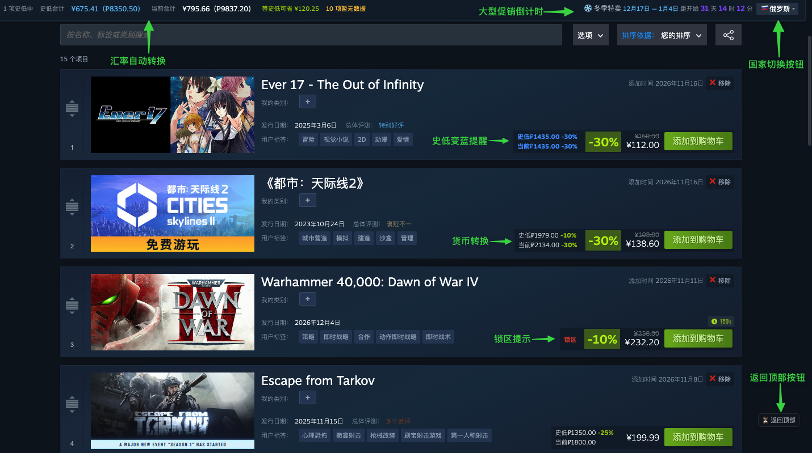
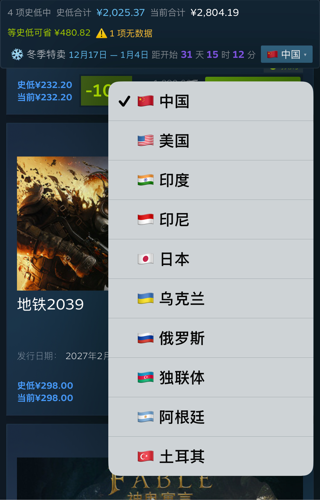
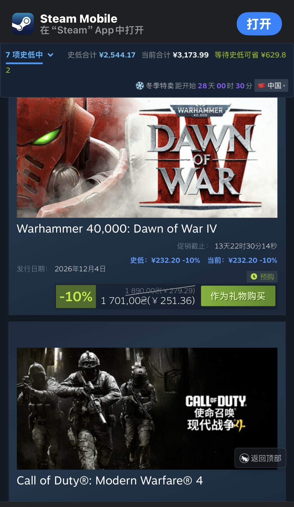
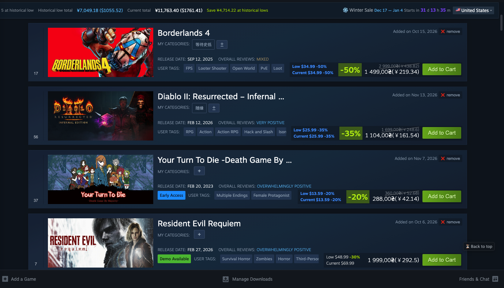
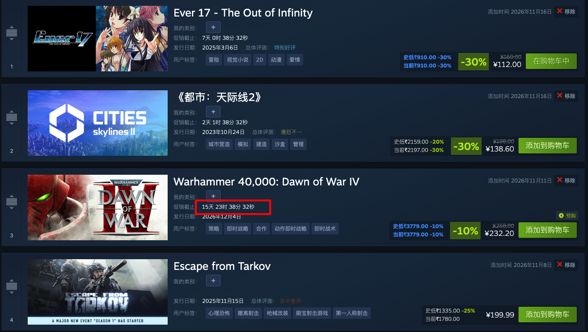
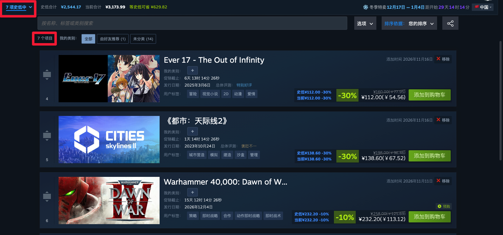
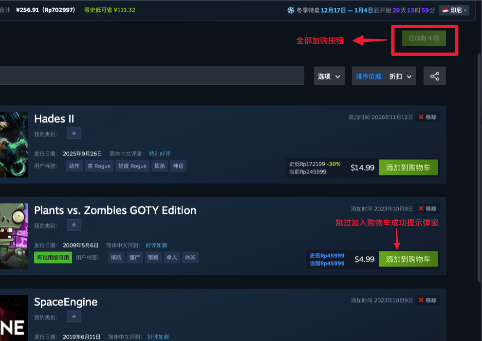

  <h1>
    
    Steam Wishlist Enhancer
  </h1>

> [!NOTE]
> This script only works on the **[Steam Wishlist](https://store.steampowered.com/wishlist)**. All data is for display and reference only. It will not modify your Steam account data, so you can use it safely.

## [Table of Contents](#table-of-contents)

> Click a **section title** to jump to the corresponding content 
> Click the blue heading in each section to return to the table of contents

> * [Core Features](#core-features)
>     * [Lowest Price History Check](#lowest-price-history-check)
>     * [Summary & Statistics](#summary--statistics)
>     * [Seasonal Sale Countdown](#seasonal-sale-countdown)
> * [Screenshots](#screenshots)
>     * [Overview](#table-of-contents)
>     * [Region Switcher](#table-of-contents)
>     * [Mobile Support](#table-of-contents)
>     * [Steam Client Support](#table-of-contents)
>     * [Sale Countdown](#table-of-contents)
>     * [Show Only Record Lows](#table-of-contents)
>     * [Add All to Cart](#table-of-contents)
> * [Installation & Usage](#installation--usage)
> * [Permissions & Data Sources](#permissions--data-sources)
> * [Notes](#notes)
> * [License](#license)

---

## [Core Features](#table-of-contents)
### 🏷️ [Lowest Price History Check](#table-of-contents)
- Directly shows current prices and historical lowest prices across multiple regions for games on your wishlist.
- Supported regions: China 🇨🇳, United States 🇺🇸, India 🇮🇳, Indonesia 🇮🇩, Japan 🇯🇵, Ukraine 🇺🇦, Russia 🇷🇺, CIS 🇦🇿, Argentina 🇦🇷, Turkey 🇹🇷.
- Automatic data source selection by region: ITAD for China / US / India / Indonesia / Japan; Xiaoheihe API for Ukraine / Russia / CIS / Argentina / Turkey.
- Record-low prices are highlighted in blue, with discount percentage and missing-data warnings.
- Price caching: considered fresh within 30 minutes, maximum retention 24 hours; request throttling to reduce API calls.

### 📊 [Summary & Statistics](#table-of-contents)
- Displays total current price and total historical lowest price for your wishlist.
- Shows estimated savings if waiting for record-low prices.
- Converted to CNY by exchange rate; original currency totals are shown where applicable.

### ⏱️ [Seasonal Sale Countdown](#table-of-contents)
- Countdown timer for Steam seasonal sales: Winter, Spring, Summer, Autumn Sale.
- Supports countdown to sale start / sale end.

---

## 📸 [Screenshots](#table-of-contents)
### Overview

Automatically loads wishlist games and displays current price + historical low price. The summary bar at the top shows total current price, total record-low price and estimated savings. For large wishlists, due to API limits, price data is fetched first for the top 100 games sorted by AppID. Remaining games are loaded lazily.

### Region Switcher

A region dropdown selector is placed in the top summary bar. Switching regions will reload prices for the selected region and cache data locally.

### Mobile Support

### Steam Client Support

The UI automatically switches between English and Chinese based on Steam page / browser language. English will be enabled automatically when a non-Chinese language is detected.

### Sale Countdown

### Show Only Record Lows

### Add All to Cart

Add all wishlist items to cart in one click. When "Show Only Record Lows" is enabled, only games at their historical low price will be added.

## 📥 [Installation & Usage](#table-of-contents)

> [!TIP]
> **Recommended script managers:**
> * **PC**: [Tampermonkey](http://tampermonkey.net/)
> * **iOS**: [Stay](https://apps.apple.com/cn/app/stay-for-safari-%E7%94%A8%E6%88%B7%E8%84%9A%E6%9C%AC%E4%B8%8E%E5%B9%BF%E5%91%8A%E6%8B%A6%E6%88%AA%E6%8F%92%E4%BB%B6/id1591620171)
> * **Steam Client**: [ScriptCat](https://scriptcat.org/zh-CN)
>
> ## [Install Link](https://greasyfork.org/zh-CN/scripts/605431-steam%E6%84%BF%E6%9C%9B%E5%8D%95%E5%A2%9E%E5%BC%BA)

---

## 🔒 [Permissions & Data Sources](#table-of-contents)

The script sends requests to these domains:
- `api.augmentedsteam.com`: Augmented Steam price & historical low data
- `shturl.cc/FhcQqt`: Xiaoheihe historical low data
- `api.steampowered.com`: Steam store & regional price data
- `store.steampowered.com`: Steam wishlist & store page data
- `partner.steamgames.com`: Steam seasonal sale page
- `open.er-api.com`: Exchange rate data

---

## 📝 [Notes](#table-of-contents)

> [!note]
> **Notice:**
> Prices and historical lows are for reference only. Final pricing is subject to Steam checkout. Third-party data may be incomplete, delayed or contain regional/currency errors. Xiaoheihe rounds prices for CIS, Turkey, Argentina and other regions; the script recalculates following Steam rules, but minor discrepancies may still exist.
> Price data is stored locally: regular prices cached for 30 minutes (max 24h), exchange rates cached for 24h, sale info cached for 6h to reduce repeated requests. Switching region or refreshing the page triggers a fresh price fetch.
> Your Steam account credentials and cookies are never uploaded to third parties. All requests fetch public price and wishlist information. Owned game list is read locally in your browser and never transmitted externally. All runtime data is stored locally.

---

## 📄 [License](#license)

[MIT](https://github.com/beerleexc/Steam-Wishlist-Enhancer/blob/main/LICENSE)

Author: **beerlee**
Version: **1.8.0**
