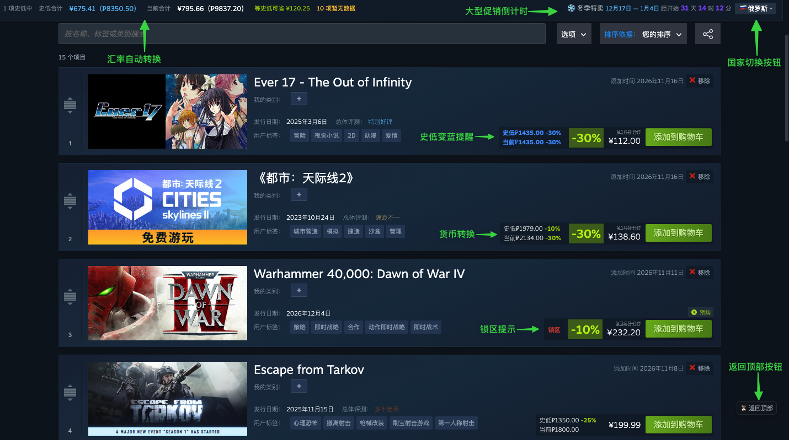
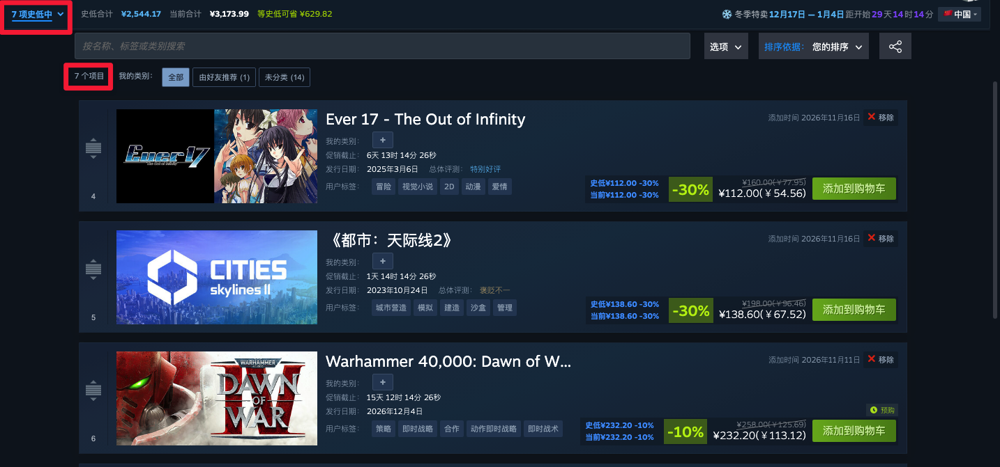
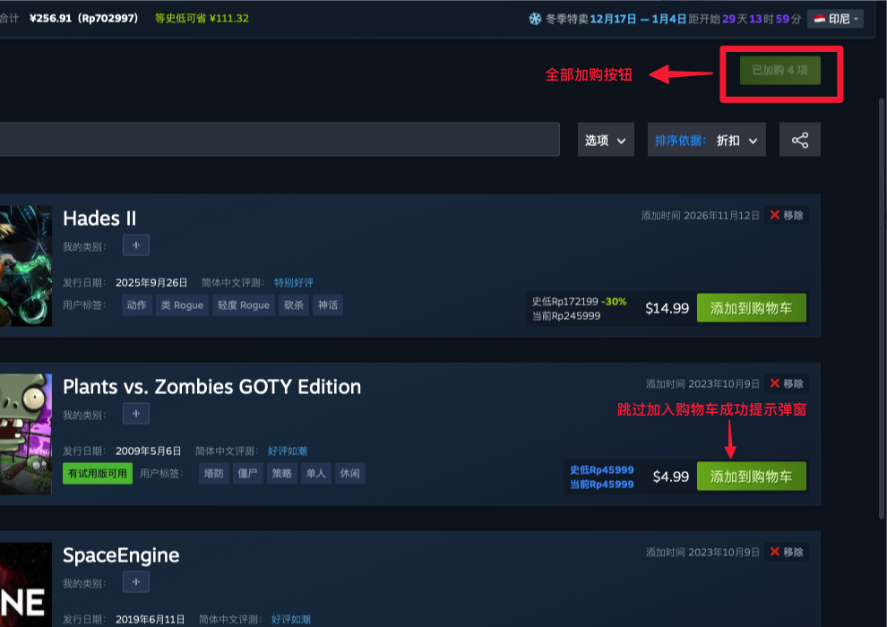

  <h1>
    
    Steam Wishlist Enhancer
  </h1>

> [!NOTE]
> 本脚本仅作用于 **[Steam 愿望单](https://store.steampowered.com/wishlist)**，所有数据仅供展示与参考，不会修改您的 Steam 账户数据，请放心使用。

## [使用目录](#使用目录)

> 点击 **目录标题** 可以快速定位到相关正文 
> 点击正文的 **蓝色标题** 可以快速回到目录

> * [核心功能](#核心功能)
>     * [史低查询](#史低查询)
>     * [汇总与统计](#汇总与统计)
>     * [季节特卖倒计时](#季节特卖倒计时)
> * [效果展示](#效果展示)
>     * [功能概览](#使用目录)
>     * [国家切换](#使用目录)
>     * [移动端适配](#使用目录)
>     * [客户端适配](#使用目录)
>     * [折扣倒计时](#使用目录)
>     * [只看史低](#使用目录)
>     * [一键加购](#使用目录)
> * [使用与安装](#使用与安装)
> * [权限与数据来源](#权限与数据来源)
> * [说明](#说明)
> * [License](#license)

---

## [核心功能](#使用目录)
### 🏷️ [史低查询](#使用目录)
- 在愿望单中直接显示每个游戏的多地区当前价格与历史最低价。
- 支持切换查询地区：中国🇨🇳、美国🇺🇸、印度🇮🇳、印尼🇮🇩、日本🇯🇵、乌克兰🇺🇦、俄罗斯🇷🇺、独联体🇦🇿、阿根廷🇦🇷、土耳其🇹🇷。
- 按地区自动选择历史最低价来源：中国/美国/印度/印尼/日本使用 [ITAD](https://isthereanydeal.com/) ；乌克兰/俄罗斯/独联体/阿根廷/土耳其使用小黑盒 API。
- 史低价格蓝色高亮、折扣百分比、无数据警告。
- 价格缓存：30 分钟内视为新鲜，最长保留 24 小时；请求节流，减少 API 调用。

### 📊 汇总与统计](#使用目录)
- 显示愿望单“当前合计”和“史低合计”。
- 显示“等史低可省”金额。
- 按汇率折算为人民币；在适用时显示非人民币原币种合计。

### ⏱️ [折扣和特卖倒计时](#使用目录)
- 显示 Steam 季节特卖倒计时：冬季、春季、夏季、秋季特卖。
- 支持“距开始 / 距结束”倒计时。

---

## 📸 [效果展示](#使用目录)
### 功能概览

自动加载愿望单游戏，显示当前价格、历史史低价；愿望单顶部汇总栏展示：史低合计、当前合计、预估节省金额。愿望单数量较多时，由于史低价格接口的限制，会优先抓取计算ID排序前100的游戏。余下游戏采取懒加载策略。

### 国家切换

页面顶部汇总栏有地区下拉选择器，可切换国家。切换后会重新拉取对应地区价格，本地缓存价格数据。

### 移动端适配

### 客户端适配

脚本会根据steam页面/浏览器语言自动切换中文/英文 UI。检测非中文语言时会自动切换至英文。

### 折扣倒计时

### 只看史低

### 购物车一键全部加购

可以加购整个愿望单，开启“只看史低”时，仅把史低游戏加入购物车。开启脚本会会自动跳过 steam 的加入购物车成功提示的弹窗。

## 📥 [使用与安装](#使用目录)

> [!TIP]
> **推荐搭配脚本管理器使用：**
> * **PC端**：推荐使用 [Tampermonkey](http://tampermonkey.net/)
> * **iOS端**：推荐使用 [Stay](https://apps.apple.com/cn/app/stay-for-safari-%E7%94%A8%E6%88%B7%E8%84%9A%E6%9C%AC%E4%B8%8E%E5%B9%BF%E5%91%8A%E6%8B%A6%E6%88%AA%E6%8F%92%E4%BB%B6/id1591620171)
> * **Steam客户端**：推荐使用 [脚本猫](https://scriptcat.org/zh-CN)
> ## [安装地址](https://greasyfork.org/zh-CN/scripts/605431-steam%E6%84%BF%E6%9C%9B%E5%8D%95%E5%A2%9E%E5%BC%BA)
---

## 🔒 [权限与数据来源](#使用目录)

脚本会请求以下域名：
- `api.augmentedsteam.com`：Augmented Steam 价格/史低数据
- `api.xiaoheihe.cn`：小黑盒史低数据
- `api.steampowered.com`：Steam 商店/地区价格数据
- `store.steampowered.com`：Steam 愿望单/商店数据
- `partner.steamgames.com`：Steam 季节特卖活动页
- `open.er-api.com`：汇率数据

---

## 📝 [说明](#使用目录)

> [!note]
> **注意：**
> 价格与史低数据仅供参考，最终价格以 Steam 结算页为准。第三方数据可能缺失、延迟或存在地区/货币误差。小黑盒对独联体、土耳其、阿根廷等地区价格存在取整，脚本会按 Steam 规则重算，但仍可能有误差。
> 价格数据会自动存入脚本存储，普通价格缓存30分钟，最长保留24小时，汇率缓存24小时，特卖信息缓存6小时，减少重复网络请求。切换地区、页面刷新会重新拉取价格。
> 脚本不会上传你的Steam账号、Cookie给第三方；所有请求均为获取公开价格、愿望单列表；账号已拥有游戏列表仅在本地浏览器读取，不会外传。脚本运行所需数据将储存在本地。

---

## 📄 [License](#使用目录)

[MIT](https://github.com/beerleexc/Steam-Wishlist-Enhancer/blob/main/LICENSE)

作者：**beerlee**  
版本：**1.8.0**
